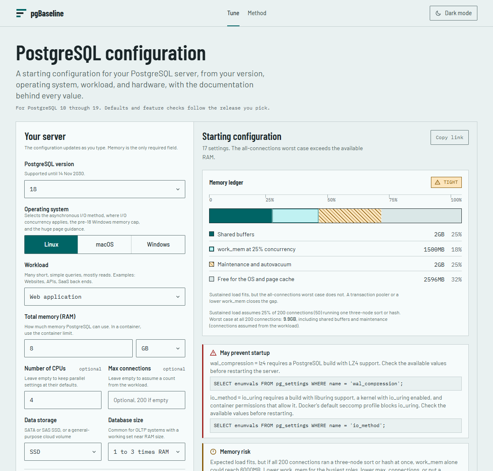

# pgBaseline

A starting configuration for your PostgreSQL server, from your version, operating system, workload, and hardware, with the documentation behind every value.

[](https://github.com/rezalabs/pgBaseline/actions/workflows/ci.yml) [](LICENSE) [](#how-the-result-is-produced)



Live site: [rezalabs.github.io/pgBaseline](https://rezalabs.github.io/pgBaseline/).

The site is static: it builds to plain HTML, CSS, and JavaScript, runs entirely in the browser, and deploys to GitHub Pages without a server, database, or build-time data service.

## Quick start

Requirements: Node.js 22.22.2 or newer on the 22 line, 24.15 or newer on the 24 line, or 26 and later.

```bash
npm ci
npm run dev       # http://127.0.0.1:5173/
```

Production build and local preview:

```bash
npm run build
npm run preview
```

`npm run build` writes `dist/` and copies `dist/index.html` to `dist/404.html`, so deep links such as `/method` work on a static host that serves `404.html` for unknown paths.

## Scripts

| Command             | What it does                                            |
| ------------------- | ------------------------------------------------------- |
| `npm run dev`       | Development server with hot reload                      |
| `npm run build`     | Production build plus the `404.html` app shell          |
| `npm run preview`   | Serve the production build locally                      |
| `npm run lint`      | ESLint plus Prettier check                              |
| `npm run format`    | Apply Prettier                                          |
| `npm run typecheck` | `svelte-check` with the strict TypeScript configuration |
| `npm run knip`      | Report unused files, exports, and dependencies          |
| `npm test`          | Vitest unit and component tests                         |

## Deployment to GitHub Pages

The workflow in `.github/workflows/pages.yml` builds and publishes the site on every push to `main` and on manual dispatch. `.github/workflows/ci.yml` runs the lint, type, unused-code, audit, test, and build checks on every pull request and every push to `main`.

1. In the repository settings, set **Pages → Build and deployment → Source** to **GitHub Actions**.
2. Push to `main`, or run the workflow manually.

The workflow reads the site's base path from the Pages configuration, which is `/<repository>` for a project site and empty for a user site or a custom domain, and passes it to the build as `BASE_PATH`. The trailing slash is optional. To build for a different base locally:

```bash
BASE_PATH=/my-repository npm run build
```

On Windows Git Bash, prefix that command with `MSYS2_ENV_CONV_EXCL=BASE_PATH`, because MSYS otherwise rewrites a leading-slash value into a Windows path.

GitHub Pages has no rewrite rules, so the build writes `dist/404.html` plus a directory copy of the app shell for each route (`dist/method/index.html`). Deep links return 200 and keep their own title. Add a route to `scripts/postbuild.mjs` when you add a page, otherwise its deep link falls back to the 404 shell.

## How the result is produced

Inputs are the PostgreSQL major version, operating system, workload, RAM, optional CPU and connection counts, storage type, and database size. The model in `src/lib/model/compute.ts` is pure: the same input and reference date always produce the same settings, warnings, and memory ledger.

Highlights, with the full rules in [`docs/model.md`](docs/model.md):

- `shared_buffers` follows PostgreSQL's documented 25% starting point, dropping to 15% below 1GB of RAM and 1/16 on a desktop profile.
- `work_mem` starts from `shared_buffers / max_connections`, is doubled for analytics and halved for desktop, has a 4MB floor and a workload-specific ceiling, and is reported per node rather than per connection.
- The memory ledger separates shared buffers, a sustained `work_mem` budget (25% of connections running a three-node sort or hash), the maintenance and autovacuum reserve, and the memory left for the operating system.
- Release-specific behaviour is respected: `checkpoint_completion_target` only before PostgreSQL 14, `maintenance_io_concurrency` from 13, LZ4 WAL compression from 15, `io_uring` from 18 on Linux, parallel autovacuum only in 19, and the pre-18 2GB `maintenance_work_mem` cap on Windows.
- Versions past end of life still produce a configuration, with a warning and the published end-of-life date.

Every setting carries a short rationale and one or more sources. The site links each setting to its page in the PostgreSQL documentation for the selected major version, and the Method page lists the same sources.

## Project structure

```text
src/
  lib/
    model/            pure tuning model, sources, versions, formatting
    urlState.ts       URL/form mapping and validation
    router.ts         history-based router for the two routes
    theme.ts          theme persistence
  components/         form controls, memory ledger, warnings, config view, evidence
  routes/             TunePage, MethodPage
  styles/             tokens, base styles, control primitives
scripts/postbuild.mjs 404 shell, route copies, and license files for dist/
.github/workflows/    CI, security scan, Pages deployment, release
docs/model.md         the tuning rules and their sources in full
```

The site ships its own compiled application code and the three bundled font families. No framework runtime is loaded from a CDN and no third-party script runs in the browser.

## Accessibility

- Semantic form controls with visible labels, hints and errors shown next to their field and connected to it through `aria-describedby`.
- The OS choice is a radio group inside a `fieldset` with a `legend`; the configuration tabs follow the ARIA tabs pattern with arrow, Home, and End keys.
- Status messages for regeneration and copy results use live regions.
- Both themes are checked against WCAG AA for body text, and control boundaries and focus rings meet the 3:1 non-text requirement.
- The layout reflows to 320 CSS pixels without page-level horizontal overflow; wide output scrolls inside its own labelled region.

## Data and privacy

The site has no backend, no analytics, and no account, and every request the page makes is for a file on this site's own origin. The form values live in the URL query string, which is what makes a result link reproduce the configuration, and the theme preference is the only value kept in `localStorage`.

## Known limitations

- The result is a starting point, not a benchmark. Query plans, indexes, and schema design usually matter more.
- Managed services can override these values through parameter groups.
- The model does not tune per-table autovacuum thresholds, pooling, replication, or backup settings.

## Contributing

The project is maintained by [RezaLabs](https://rezalabs.com) and does not accept outside pull requests. Bug reports and corrections to the tuning rules are welcome in [issues](https://github.com/rezalabs/pgBaseline/issues).

## Security

Report vulnerabilities privately through [GitHub private vulnerability reporting](https://github.com/rezalabs/pgBaseline/security/advisories/new); do not open a public issue. [SECURITY.md](SECURITY.md) lists the supported versions and what to include in a report.

## AI-assisted development

Parts of the code, tests, and documentation were drafted with AI coding assistants and reviewed by the maintainer, who remains responsible for correctness, licensing, and security. The instructions given to those assistants are in [AGENTS.md](AGENTS.md).

## Credits

This project was inspired by [PGTune](https://github.com/le0pard/pgtune), a hardware-based PostgreSQL tuning tool. PGTune is MIT licensed, and this project reuses material from it: the shape of the generated configuration and the order of its settings, the selection of settings for each database type, several explanatory sentences and warning texts, and the database type, storage, and size labels. That reuse is why its copyright notice and license are reproduced in [THIRD-PARTY-NOTICES.md](THIRD-PARTY-NOTICES.md).

This project's own work is the Svelte implementation, the memory ledger, the per-setting evidence with documentation links, version support and end-of-life handling, the research citations, and the interface design. Where the rules differ from PGTune, the difference is deliberate; the Method page in the site (`src/routes/MethodPage.svelte`) lists them.

The tuning rules rest on the PostgreSQL documentation and the sources listed in `src/lib/model/sources.ts`. The typefaces are Barlow, Barlow Condensed, and IBM Plex Mono, bundled through `@fontsource` under the SIL Open Font License.

## License

MIT. See [LICENSE](LICENSE). Copyright (c) 2026 RezaLabs. Reused portions of PGTune remain under its MIT notice in [THIRD-PARTY-NOTICES.md](THIRD-PARTY-NOTICES.md), which also carries the font licenses.

## Links

- Live site: [rezalabs.github.io/pgBaseline](https://rezalabs.github.io/pgBaseline/)
- Source: [github.com/rezalabs/pgBaseline](https://github.com/rezalabs/pgBaseline)
- Publisher: [rezalabs.com](https://rezalabs.com)
- Changelog: [CHANGELOG.md](CHANGELOG.md)
- Security: [SECURITY.md](SECURITY.md)
- Support: [ko-fi.com/rezalabs](https://ko-fi.com/rezalabs)
